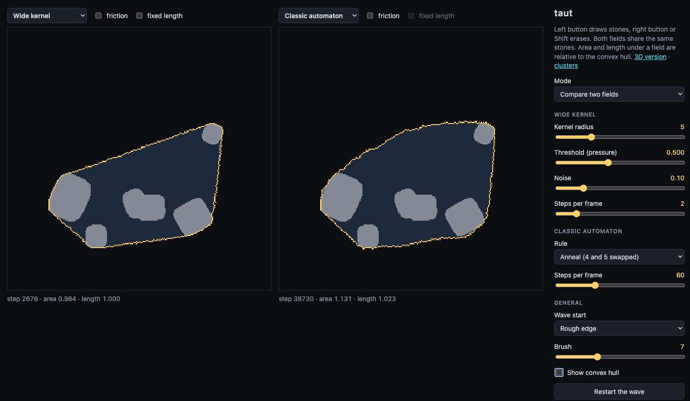
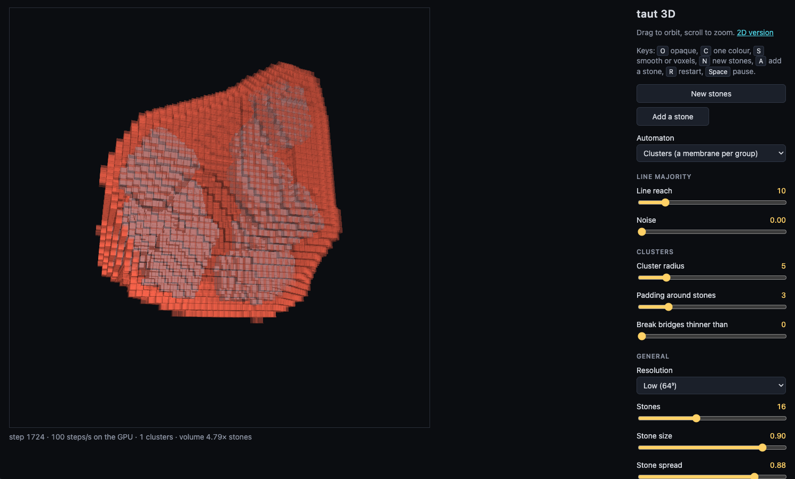
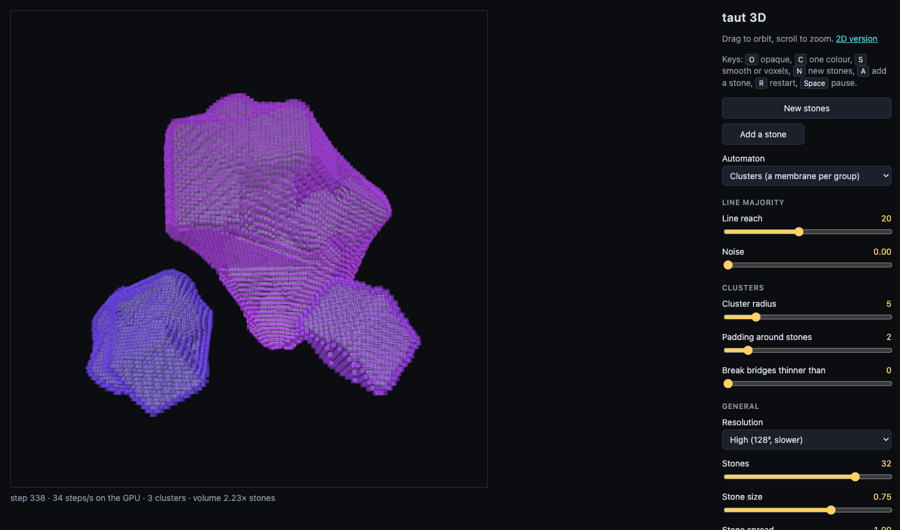
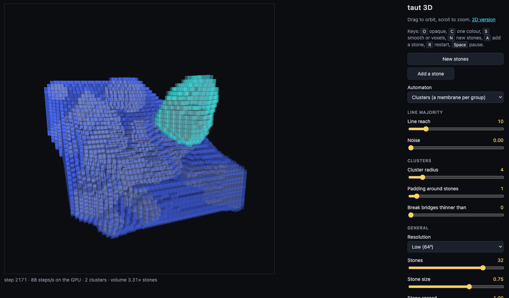
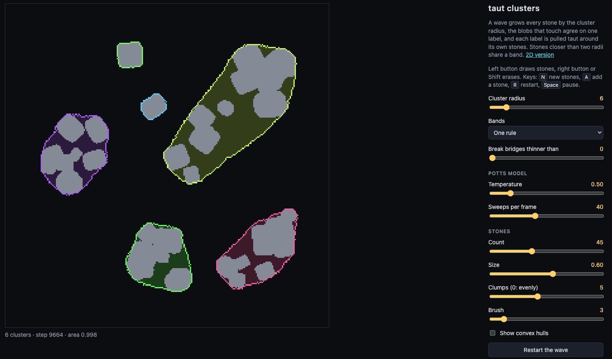

# taut

A rubber band on a cellular automaton: the outside phase floods in from the
field borders as a wave and pulls taut around the stones.



The field is binary ("outside" / "inside"), the band is the boundary between
the two phases, and stones are frozen in the inside phase. There are two fields
sharing the same stones; each one runs its own automaton with its own options:

- **Wide kernel** — threshold dynamics (Merriman–Bence–Osher): three box-blur
  passes, a threshold, and noise near the front.
- **Classic automaton** — Moore neighbourhood (9 cells including the cell
  itself), no weights and no randomness. Two Vichniac rules: majority and anneal.
- **Potts model** — Metropolis updates on the front cells; energy = tension
  (unlike neighbour pairs) + pressure × area.
- **Growth from stones** — a cell becomes inside when, on opposite sides of it
  at equal distance within the radius, there are already inside cells. It does
  not bridge gaps wider than two radii.

Options that can be combined on a field:

- **Friction** — free cells within two steps of a stone resist turning outside
  (wide kernel, classic, Potts).
- **Fixed length** — the band is never shorter than the given length: while it
  is shorter, it is pushed outwards from the inside (wide kernel, Potts).

The reference to check against is the exact convex hull of the stones, drawn as
a dashed line.

## 3D version

`3d.html` carries the same idea into a voxel field: a membrane floods in from
outside and pulls taut around stones. The simulation runs on the CPU; the
voxels are drawn with WebGL2 by casting a ray per pixel through a 3D texture,
with the membrane translucent and the stones opaque. Stones are rounded boxes
turned at random angles: each is a signed distance function placed in world
space first and only then sampled into voxels.



There are two automata:

- **Line majority** — a cell is inside when, along at least one of 49 lines
  through it, most cells within reach are inside. Convex bumps are shed, dents
  and necks are filled, and the membrane comes to rest stretched between the
  stones. It settles inside the convex hull, at roughly 80% of its volume,
  because sharp ridges of the hull get rounded off.
- **Wide kernel** — the direct port of the 2D threshold dynamics. In 3D it
  moves the front by mean curvature, so necks pinch off and the membrane ends
  up shrunk onto each stone separately, like a soap film rather than a wrap.

The line automaton has two kernels and a pressure control:

- **Kernel** — *thin lines* sum the raw binary cells; *soft lines* sum the
  field blurred over each cell's 3×3×3 block, which fattens every line into a
  soft tube and evens out the lattice staircase.
- **Pressure** — positive values raise the line threshold, so the membrane
  sags inwards between the stones, down to a narrow waist. Negative values
  inflate it: the settled membrane is pushed outwards by up to an eighth of
  the field and its corners rounded. Inflation is derived from the taut field
  rather than simulated, because no local rule can inflate to a limit — a rule
  that makes a flat face advance keeps it advancing.

Is it still a cellular automaton? The state is binary, every cell updates at
once, and the rule is the same everywhere and local. Three caveats:

- The neighbourhood is large and star-shaped: 49 lines through the cell, a few
  hundred cells at the default reach.
- Only cells on the front are evaluated, those with one of their six
  neighbours in the other phase. This is an optimisation, but it is also part
  of the rule: "if all six neighbours agree with you, stay as you are" is
  itself local. A cell far from the front that plain line majority would flip
  at once instead waits for the front to reach it, so the order of events
  differs; that the settled shape is the same has not been checked by a run.
- Inflation under negative pressure and the smooth surface are computed from
  the automaton's state for display and never fed back into it.

Drag to orbit, scroll to zoom. View options:

- **Surface** — the raw voxels as cubes (the default), or smooth. The smooth surface is the
  same binary field read through a coarser mip level of its 3D texture, so the
  staircase is blurred away in the shader; **Smoothness** sets how strongly.
- **Membrane** — translucent or opaque, and the stones can take its colour so
  the wrap reads as a single shell. The light comes from the camera, so
  surfaces turned away darken.
- **Stones** — their number and spread; placed anywhere, or mostly on the
  surface of a sphere with the rest inside it; all sharp-edged, all rounded,
  or mixed.
- **Resolution** — 64³, 96³, 128³ or 192³; the radii scale with it. A step of
  the line automaton takes about 3 ms at 64³ once settled and about 50 ms at
  192³, with the first steps of the wave several times slower.

Keys: `O` opaque membrane, `C` stones in membrane colour, `S` smooth or
voxels, `N` new stones, `R` restart the wave, `Space` pause.

Address parameters: `?steps=200` runs that many steps before the first frame;
`?size=128`, `?kernel=soft`, `?pressure=-0.5`, `?opaque`, `?onecolor` and
`?smooth` preset the page, as do `?stone-placement=sphere` and
`?stone-shape=sharp`. `?cpu` keeps the clusters automaton off the GPU.

### Clusters in 3D

The third automaton on `3d.html` is the one-rule clusters automaton (see
[Clusters](#clusters)) carried into the voxel field: a membrane per group of
stones. The cell state has the same five parts, read from the 26 neighbours:
nearest stone, depth, label, age and membrane. Only the tension differs. The 2D copy
rule moves a front by mean curvature, which in 3D pinches necks, so the
membrane follows the line majority rule instead, counting cells of another
label as outside. Membranes are coloured by cluster in both views.





Pulled taut around the bare stones, a membrane has no body where a cluster is
thin: two stones give a narrow bridge, three a flat sheet, one nothing at all.
So every cell within the padding of its stone is always inside, and the
membrane is taut around the stones grown by that much. Zero padding gives the
bare wrap back.

The rule runs on the GPU. The state of a cell is two texels in 3D textures,
12 bytes in all, and a fragment shader applies the rule to one layer of the
field at a time, writing into a second pair of textures that then swaps with
the first. The picture is made from the state on the GPU as well, so nothing
is copied back apart from the labels every 32 steps, to count the clusters
and the volume. On one machine that gave about 140 steps a second at 64³, 39
at 128³ and 12 at 192³.

`?cpu` in the address runs the same rule on the CPU instead, as does a
browser where the GPU version fails to start. There a step takes about 50 ms
at 64³ while the labels settle and 7 ms afterwards, and about 400 ms at 128³
while they settle. On the same stones the two versions gave the same clusters
and the same volume.

## Clusters



`clusters.html` puts a band around every group of stones instead of one around
all of them. Tension alone cannot do that: a front moved by curvature always
ends up convex, whichever side it starts from. What is needed is a finite
scale, the cluster radius, and a few stages of local rules:

1. **Wave from the stones** — every cell keeps the offset to the nearest stone
   it has heard of and takes a shorter one from its 8 neighbours, up to the
   cluster radius. This grows each stone by a disc of that radius.
2. **Labels** — every grown cell starts with its own label and keeps taking
   the smallest label among its neighbours. Blobs that touch end up with one
   label, so stones closer than two radii fall into one cluster. This is
   single-linkage clustering with that distance as the threshold.
3. **Bands** — every label is pulled taut around its own stones, in one of two
   ways.

**One field, many labels.** Nothing leaves the field: the label is the cell
state. The labelled blobs first swell by a few cells, an outside cell joining
the label next to it unless it sees two different ones, which keeps the
clusters apart and fattens a blob where two of its stones are only just
linked. Then a single Potts model with as many states as there are labels
tightens all the bands at once: a front cell copies the state of a random
neighbour by the Metropolis rule. A pair of cells with two different labels
costs more than two label-outside pairs, so the outside phase seeps in between
two bands and they never merge. With that repulsion below 2 they stick together
like soap bubbles instead. A band cannot pass through another one: where two
hulls would overlap, the bands press on each other.

**A layer per cluster.** Each label gets a field of its own with only its
stones in it, and a band that starts as a fat blob around them and is pulled
taut by the two-state Potts model or the wide kernel. The layers are
independent, so the bands may cross, and each one settles on the exact convex
hull of its own cluster.

**One rule.** The stages above are switched from outside: something has to
notice that the wave or the labels have stopped. This version has no stages
and no clock. Every cell applies the same rule on every step, all at once,
reading only its 8 neighbours, and the cell state has five parts updated
together:

- *nearest stone* — the offset to the nearest stone heard of so far, never
  limited by a radius, so every cell ends up knowing which stone it belongs to;
- *depth* — for a cell within the cluster radius of a stone, how far it is
  from the nearest cell that is not: one step more than the smallest depth
  among its neighbours;
- *label* — on a stone, or within the cluster radius of one and deep enough,
  the smallest label among such neighbours; elsewhere, the label of the
  neighbour towards the nearest stone, which spreads every cluster's label
  over its whole territory;
- *age* — steps since the label last changed here or nearby;
- *band* — inside or outside. A young cell close to its stone is inside, so a
  cluster stays in one fat piece while its labels are still settling. An old
  cell follows tension: it copies a random neighbour by the Metropolis rule,
  counting cells of another label as outside.

The rule is probabilistic and the starting state gives every cell a label of
its own. A band lives inside its cluster's territory, the cells nearer to its
stones than to any others, so where a hull would reach into a neighbour's
territory the band is cut along the border between them.

**Bands that may overlap.** In the one rule a cell holds one label, so it
belongs to one cluster, and a band stops at the border of its territory. In
*One rule, bands may overlap* a cell has room for several bands: its state
has a few channels, each with a band of its own, and every cluster keeps its
band in one of them. In its channel a band meets only the clusters that share
the channel, so it reaches its full hull and runs over a neighbour that lives
in another one. It is still one rule applied by every cell at once.

The clusters are found as before. The channel of a cluster follows from its
label and from a counter, its turn. A cell takes the largest turn among the
neighbours of its label, and where it touches a settled cluster of a smaller
label in the same channel it adds one: the cluster with the larger label
moves on to the next channel. In each channel a cell keeps the distance to
the nearest stone of that channel, taken afresh from its neighbours on every
step, so when a cluster leaves a channel the distances around it grow until
they fit again. With four channels neighbouring clusters ended up apart in
every run tried; with fewer, some share a channel and cut each other as in
the plain one rule.

**Thin bridges.** Single linkage chains: a row of stones, each close enough
to the next, joins two groups that have nothing else in common. The depth is
there to break such chains. With *Break bridges thinner than* above zero a
label spreads only through cells at least half that deep, so two groups join
only where the grown stones meet in a neck at least that wide. A row of
stones makes a narrow neck and falls apart into single stones; a group whose
stones surround each other fills in and stays whole. The cluster radius alone
cannot tell the two apart when the spacing is the same. At zero the depth
decides nothing and the clusters are the single-linkage ones. The same slider
is on the 3D page.

**Stones on the fly.** *Add a stone* (key `A`) drops one more stone without
starting over, and so does drawing one; the 3D page has the same button and
key. A new stone cell is told only that it is a stone and given a label of
its own. The wave from it, the labels and the band follow by the same rule:
a new stone can join clusters but never split one, and the labels only ever
merge. The band swells again around the change, within a few dozen cells of
it, and is pulled taut once more. Erasing a stone can split a cluster, so it
starts over. For this to work a cell that hears of a nearer stone takes the
label of the neighbour it heard it from, dropping the one it had.

Stones are scattered in clumps around a few centres, with a few strays
anywhere, so that there are clusters to find; *Clumps* at zero scatters them
evenly. The 3D page has the same as a stone placement.

The exact hulls are drawn dashed. With many small stones the Potts model is
the choice, because the wide kernel erases anything thinner than its radius, a
band stretched between two small stones included. As the cluster radius grows
the clusters merge, and at the top it is the single hull again.

## Running

```sh
npm install
npm run dev
```

## Controls

- Left mouse button draws stones, right button or Shift erases.
- **Mode** — two fields side by side, or the left field alone.
- **Automaton and options** — chosen above each field; an option is greyed out
  when the automaton does not support it.
- **Kernel radius** — the scale below which details are ignored, and how fast
  the band tightens.
- **Threshold** — 0.5 is pure tension; higher adds inward pressure, so the band
  sags between stones or slips through the gaps.
- **Noise** — unpins the front from the lattice; at zero the band gets stuck
  before reaching the hull.
- **Rule** — majority freezes almost at once; anneal tightens onto the hull, but
  only from a rough edge and about fifty times slower than the wide kernel.
- **Temperature** and **Pressure** (Potts) — temperature keeps the front
  moving; positive pressure squeezes the band, negative inflates it.
- **Neighbourhood radius** (growth) — how far a cell looks for a pair of inside
  cells around it.
- **Grip strength** — how hard the cells next to a stone hold on.
- **Band length** — the target length, in lengths of the convex hull.
- **Wave start** — a straight edge, an inscribed circle, or an edge with random
  pits.

The numbers under each field are the step count and the band's area and length
relative to the convex hull; a taut band reads 1.000 for both.
