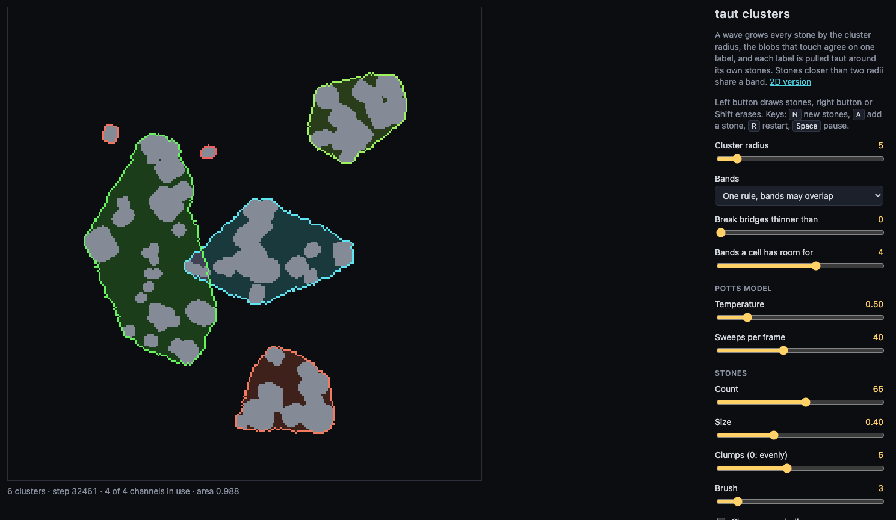

# taut

A rubber band on a cellular automaton: the outside phase floods in from the
field borders as a wave and pulls taut around the stones.

Run it in the browser: https://geotyper.github.io/taut/ (cells: https://geotyper.github.io/taut/cells.html).


The field is binary ("outside" / "inside"), the band is the boundary between
the two phases, and stones are frozen in the inside phase. There are two fields
sharing the same stones; each one runs its own automaton with its own options:

- **Wide kernel** — threshold dynamics (Merriman–Bence–Osher): three box-blur
  passes, a threshold, and noise near the front.
- **Classic automaton** — Moore neighbourhood (9 cells including the cell
  itself), no weights and no randomness. Two Vichniac rules: majority and anneal.
- **Potts model** — Metropolis updates on the front cells; energy = tension
  (unlike neighbour pairs) + pressure × area.
- **Growth from stones** — a cell becomes inside when, on opposite sides of it
  at equal distance within the radius, there are already inside cells. It does
  not bridge gaps wider than two radii.

Options that can be combined on a field:

- **Friction** — free cells within two steps of a stone resist turning outside
  (wide kernel, classic, Potts).
- **Fixed length** — the band is never shorter than the given length: while it
  is shorter, it is pushed outwards from the inside (wide kernel, Potts).

The reference to check against is the exact convex hull of the stones, drawn as
a dashed line.

## 3D version

`3d.html` carries the same idea into a voxel field: a membrane floods in from
outside and pulls taut around stones. The simulation runs on the CPU; the
voxels are drawn with WebGL2 by casting a ray per pixel through a 3D texture,
with the membrane translucent and the stones opaque. Stones are rounded boxes
turned at random angles: each is a signed distance function placed in world
space first and only then sampled into voxels.


There are two automata:

- **Line majority** — a cell is inside when, along at least one of 49 lines
  through it, most cells within reach are inside. Convex bumps are shed, dents
  and necks are filled, and the membrane comes to rest stretched between the
  stones. It settles inside the convex hull, at roughly 80% of its volume,
  because sharp ridges of the hull get rounded off.
- **Wide kernel** — the direct port of the 2D threshold dynamics. In 3D it
  moves the front by mean curvature, so necks pinch off and the membrane ends
  up shrunk onto each stone separately, like a soap film rather than a wrap.

The line automaton has two kernels and a pressure control:

- **Kernel** — *thin lines* sum the raw binary cells; *soft lines* sum the
  field blurred over each cell's 3×3×3 block, which fattens every line into a
  soft tube and evens out the lattice staircase.
- **Pressure** — positive values raise the line threshold, so the membrane
  sags inwards between the stones, down to a narrow waist. Negative values
  inflate it: the settled membrane is pushed outwards by up to an eighth of
  the field and its corners rounded. Inflation is derived from the taut field
  rather than simulated, because no local rule can inflate to a limit — a rule
  that makes a flat face advance keeps it advancing.

Is it still a cellular automaton? The state is binary, every cell updates at
once, and the rule is the same everywhere and local. Three caveats:

- The neighbourhood is large and star-shaped: 49 lines through the cell, a few
  hundred cells at the default reach.
- Only cells on the front are evaluated, those with one of their six
  neighbours in the other phase. This is an optimisation, but it is also part
  of the rule: "if all six neighbours agree with you, stay as you are" is
  itself local. A cell far from the front that plain line majority would flip
  at once instead waits for the front to reach it, so the order of events
  differs; that the settled shape is the same has not been checked by a run.
- Inflation under negative pressure and the smooth surface are computed from
  the automaton's state for display and never fed back into it.

Drag to orbit, drag with the right button or Shift to move the view, scroll
to zoom, double-click to bring the view back to the middle; the same on the
foam and wire pages (`src/3d/orbit.ts`). View options:

- **Surface** — the raw voxels as cubes (the default), or smooth. The smooth surface is the
  same binary field read through a coarser mip level of its 3D texture, so the
  staircase is blurred away in the shader; **Smoothness** sets how strongly.
- **Membrane** — translucent or opaque, and the stones can take its colour so
  the wrap reads as a single shell. The light comes from the camera, so
  surfaces turned away darken.
- **Stones** — their number and spread; placed anywhere, or mostly on the
  surface of a sphere with the rest inside it; all sharp-edged, all rounded,
  or mixed. With *Stones lie on a floor* the placement only chooses where a
  stone lands: every stone is dropped onto one horizontal plane and rests on
  it with its lowest point, so the scene is a layer of stones rather than a
  cloud.
- **Resolution** — 64³, 96³, 128³ or 192³; the radii scale with it. A step of
  the line automaton takes about 3 ms at 64³ once settled and about 50 ms at
  192³, with the first steps of the wave several times slower.

Keys: `O` opaque membrane, `C` stones in membrane colour, `S` smooth or
voxels, `N` new stones, `R` restart the wave, `Space` pause.

Address parameters: `?steps=200` runs that many steps before the first frame;
`?size=128`, `?kernel=soft`, `?pressure=-0.5`, `?opaque`, `?onecolor`,
`?smooth` and `?floor` preset the page, as do `?stone-placement=sphere` and
`?stone-shape=sharp`. `?cpu` keeps the clusters automaton off the GPU.

### Clusters in 3D

The third automaton on `3d.html` is the one-rule clusters automaton (see
[Clusters](#clusters)) carried into the voxel field: a membrane per group of
stones. The cell state has the same five parts, read from the 26 neighbours:
nearest stone, depth, label, age and membrane. Only the tension differs. The 2D copy
rule moves a front by mean curvature, which in 3D pinches necks, so the
membrane follows the line majority rule instead, counting cells of another
label as outside. Membranes are coloured by cluster in both views.


Pulled taut around the bare stones, a membrane has no body where a cluster is
thin: two stones give a narrow bridge, three a flat sheet, one nothing at all.
So every cell within the padding of its stone is always inside, and the
membrane is taut around the stones grown by that much. Zero padding gives the
bare wrap back.

The rule runs on the GPU. The state of a cell is two texels in 3D textures,
12 bytes in all, and a fragment shader applies the rule to one layer of the
field at a time, writing into a second pair of textures that then swaps with
the first. The picture is made from the state on the GPU as well, so nothing
is copied back apart from the labels every 32 steps, to count the clusters
and the volume. On one machine that gave about 140 steps a second at 64³, 39
at 128³ and 12 at 192³.

`?cpu` in the address runs the same rule on the CPU instead, as does a
browser where the GPU version fails to start. There a step takes about 50 ms
at 64³ while the labels settle and 7 ms afterwards, and about 400 ms at 128³
while they settle. On the same stones the two versions gave the same clusters
and the same volume.

## Clusters


`clusters.html` puts a band around every group of stones instead of one around
all of them. Tension alone cannot do that: a front moved by curvature always
ends up convex, whichever side it starts from. What is needed is a finite
scale, the cluster radius, and a few stages of local rules:

1. **Wave from the stones** — every cell keeps the offset to the nearest stone
   it has heard of and takes a shorter one from its 8 neighbours, up to the
   cluster radius. This grows each stone by a disc of that radius.
2. **Labels** — every grown cell starts with its own label and keeps taking
   the smallest label among its neighbours. Blobs that touch end up with one
   label, so stones closer than two radii fall into one cluster. This is
   single-linkage clustering with that distance as the threshold.
3. **Bands** — every label is pulled taut around its own stones, in one of two
   ways.

**One field, many labels.** Nothing leaves the field: the label is the cell
state. The labelled blobs first swell by a few cells, an outside cell joining
the label next to it unless it sees two different ones, which keeps the
clusters apart and fattens a blob where two of its stones are only just
linked. Then a single Potts model with as many states as there are labels
tightens all the bands at once: a front cell copies the state of a random
neighbour by the Metropolis rule. A pair of cells with two different labels
costs more than two label-outside pairs, so the outside phase seeps in between
two bands and they never merge. With that repulsion below 2 they stick together
like soap bubbles instead. A band cannot pass through another one: where two
hulls would overlap, the bands press on each other.

**A layer per cluster.** Each label gets a field of its own with only its
stones in it, and a band that starts as a fat blob around them and is pulled
taut by the two-state Potts model or the wide kernel. The layers are
independent, so the bands may cross, and each one settles on the exact convex
hull of its own cluster.

**One rule.** The stages above are switched from outside: something has to
notice that the wave or the labels have stopped. This version has no stages
and no clock. Every cell applies the same rule on every step, all at once,
reading only its 8 neighbours, and the cell state has five parts updated
together:

- *nearest stone* — the offset to the nearest stone heard of so far, never
  limited by a radius, so every cell ends up knowing which stone it belongs to;
- *depth* — for a cell within the cluster radius of a stone, how far it is
  from the nearest cell that is not: one step more than the smallest depth
  among its neighbours;
- *label* — on a stone, or within the cluster radius of one and deep enough,
  the smallest label among such neighbours; elsewhere, the label of the
  neighbour towards the nearest stone, which spreads every cluster's label
  over its whole territory;
- *age* — steps since the label last changed here or nearby;
- *band* — inside or outside. A young cell close to its stone is inside, so a
  cluster stays in one fat piece while its labels are still settling. An old
  cell follows tension: it copies a random neighbour by the Metropolis rule,
  counting cells of another label as outside.

The rule is probabilistic and the starting state gives every cell a label of
its own. A band lives inside its cluster's territory, the cells nearer to its
stones than to any others, so where a hull would reach into a neighbour's
territory the band is cut along the border between them.

**Bands that may overlap.** In the one rule a cell holds one label, so it
belongs to one cluster, and a band stops at the border of its territory. In
*One rule, bands may overlap* a cell has room for several bands: its state
has a few channels, each with a band of its own, and every cluster keeps its
band in one of them. In its channel a band meets only the clusters that share
the channel, so it reaches its full hull and runs over a neighbour that lives
in another one. It is still one rule applied by every cell at once.



The clusters are found as before. The channel of a cluster follows from its
label and from a counter, its turn. A cell takes the largest turn among the
neighbours of its label, and where it touches a settled cluster of a smaller
label in the same channel it adds one: the cluster with the larger label
moves on to the next channel. In each channel a cell keeps the distance to
the nearest stone of that channel, taken afresh from its neighbours on every
step, so when a cluster leaves a channel the distances around it grow until
they fit again. With four channels neighbouring clusters ended up apart in
every run tried; with fewer, some share a channel and cut each other as in
the plain one rule.

**Thin bridges.** Single linkage chains: a row of stones, each close enough
to the next, joins two groups that have nothing else in common. The depth is
there to break such chains. With *Break bridges thinner than* above zero a
label spreads only through cells at least half that deep, so two groups join
only where the grown stones meet in a neck at least that wide. A row of
stones makes a narrow neck and falls apart into single stones; a group whose
stones surround each other fills in and stays whole. The cluster radius alone
cannot tell the two apart when the spacing is the same. At zero the depth
decides nothing and the clusters are the single-linkage ones. The same slider
is on the 3D page.

**Stones on the fly.** *Add a stone* (key `A`) drops one more stone without
starting over, and so does drawing one; the 3D page has the same button and
key. A new stone cell is told only that it is a stone and given a label of
its own. The wave from it, the labels and the band follow by the same rule:
a new stone can join clusters but never split one, and the labels only ever
merge. The band swells again around the change, within a few dozen cells of
it, and is pulled taut once more. Erasing a stone can split a cluster, so it
starts over. For this to work a cell that hears of a nearer stone takes the
label of the neighbour it heard it from, dropping the one it had.

Stones are scattered in clumps around a few centres, with a few strays
anywhere, so that there are clusters to find; *Clumps* at zero scatters them
evenly. The 3D page has the same as a stone placement.

The exact hulls are drawn dashed. With many small stones the Potts model is
the choice, because the wide kernel erases anything thinner than its radius, a
band stretched between two small stones included. As the cluster radius grows
the clusters merge, and at the top it is the single hull again.

## Foam

`foam.html` has no stones. Bubbles grow from scattered centres until they
meet, and the borders between them are soap films. The state of a cell is a
label: the bubble it belongs to, or air. One rule does the growing and the
pulling taut, applied by every cell at once: a cell counts the labels in a
disc around it and takes the one with the highest count, a cell of air
counting for 0.6 of a cell of a bubble. Only the labels in a cell's 3×3 block
are candidates, so a cell whose neighbours all agree with it stays as it is.

Against air a bubble wins a cell where it holds a little over a third of the
disc, which makes it grow, by about a cell a step and nearly round. Between
two bubbles the rule is threshold dynamics with many phases (Merriman, Bence
and Osher): a film moves towards its centre of curvature, and where three
films meet they turn to equal angles. Beyond the walls nothing is counted, so
a film meets a wall squarely.

Left alone, this is grain growth rather than foam: small bubbles shrink and
vanish, and the rest get larger. By default every bubble holds on to the
area it had when the field filled up, as if the gas could not leave it: a
bubble below its area counts for more, one above it for less. The films then
settle into arcs. This part is not local, since a cell has to know the area
of the whole bubble.

A bubble smaller than about 50 squared kernel radii pushes back more gently,
by the square root of its area against that. At full strength a small
bubble overshoots: a few cells short, its whole rim takes a cell at once and
it is as far over, then back the next step, and the whole fine foam
flickered every other step, with no noise and the smallest kernel too. The
GPU works the weights out every four steps and keeps them meanwhile, so
there the push is gentler again by those four steps.

*Coarsening* chooses how a fine foam gets coarser:

- **None** — areas are kept and the foam only settles.
- **Gas seeps through the films** — areas are not kept, so the films pull
  the small bubbles in, as gas seeping from a small bubble into its
  neighbours would. A bubble with few neighbours shrinks and vanishes.
- **Films burst** — areas are kept, and now and then a film ruptures and its
  two bubbles become one, with the area of both. The film is found by
  picking cells at random until one lies on a film, so a longer film is the
  likelier to go.
- **Bubbles pop** — areas are kept, and now and then a bubble chosen at
  random bursts: its cells turn to air and the neighbours grow in.

*Bursts per 1000 steps* sets how often for the last two. They are events
from outside the rule, as a click is, and wait while there is air.

Left button starts a bubble, right button or Shift bursts one: its cells turn
to air and the neighbours grow in. *Palette* only changes the picture: *Soap
film* runs the colours of a thin film down every bubble, *Films only* leaves
the bubbles dark and colours the films.

With *Films as lines*, in *Films only*, the films are drawn as lines instead
of pixels, as the skeleton of the 3D foam is (`src/foam/lines.ts`). The cell
edges between unlike cells are walked from corner to corner and joined into
lines that end where three films meet or at the wall, or close on themselves
round a bubble inside another. Six rounds of pulling every point halfway to
the middle of its neighbours, with the ends held, take the staircase of the
cells away. Each line has a colour of its pair of bubbles and is drawn twice,
wide and faint for a glow and then thin, the light adding up where lines
meet, so the corners shine white. *Line width* sets it in screen pixels.
The lines are traced again whenever the labels change; at 1024 with 2000
bubbles, some 5900 lines, the page went from 26 to 22 steps a second.

*Fill the bubbles* puts something under the lines. *Flat colours* fills
every bubble inside the same lines, in its colour, as opaque as *Fill* says,
so fill and lines meet exactly. For that the edge
of the field is traced as well, as lines with the wall on one side that are
not drawn, and the lines round each bubble are joined end to end into
closed loops; a bubble with another inside it gets two, filled by the
even-odd rule. Air is left unfilled. *Stress, in polarised light* puts the
smoothed stress picture of the shader under the lines instead, without its
own rims, and draws the lines white over it, as the bright rims of clear
edges: the shader's colours run on smoothly across the films, and the lines
give them edges without the corners of the cells.

*Plateau borders* makes the foam wet. In a real foam the liquid gathers
where three films meet, into a wedge with three concave sides that meet the
films smoothly. Here the liquid is drawn as the whole field less the
bubbles with their corners rounded off: at every junction each bubble cuts
its corner back along its two films, as far as the slider says in sizes of a
mean bubble but never past most of a film, with a curve tangent to both.
Bubbles that share a film cut it back at the same place, so the three cut
corners make the wedge; and since every cut lies inside its own bubble, a
border never reaches out past the films, and a bubble smaller than the reach
is rounded all over. Corners on the wall and on air stay sharp. It is only a
picture: the rule still makes a dry foam, so the bubbles do not come apart
as a really wet foam would.

*Bubbles as spline shells* (experimental) draws the bubbles instead of the
films (`src/foam/shells.ts`). Every bubble becomes a closed cubic B-spline
inside its outline: its control points are the junctions round it and
points spaced evenly along each of its films, moved inwards by half the
*Line width*. A B-spline cuts the corners of its control polygon, by more
the farther apart its points are, so the shells round off at the junctions.
The field is filled with liquid and the shells are drawn over it, dark or
in their *Flat colours*, with a thin rim in their colour; the gap left
between two shells is the film, and it widens by itself into a Plateau
border at every junction. *Plateau borders* sets the spacing of the control
points, from 2 cells to 1.2 radii of a mean bubble: dry at 0, and at 0.8 the
bubbles round off and come apart in the liquid. A bubble with another
inside it gets a second loop, a hole moved the other way. The B-spline is
written out as the Béziers it is made of, so *Save as SVG* saves the very
curves drawn, one path for every bubble, in cells. At 1024 with 2000
bubbles it runs as fast as the lines.
With the stress fill the shells are cut out of the liquid as windows onto
the stress picture underneath; the SVG keeps only their outlines then.

Six more fills, made for pictures and for the mirrors, are offered with
the shells only (`src/foam/artfill.ts`), each drawn from the shell itself
so that a mirror turns it into a pattern: *Glowing spheres*, a radial
light from a little above the middle of each bubble fading to its rim;
*Neon rims*, a tube along every shell on black, a core near white inside
widening halos of its colour, drawn last and adding up, so where two
bubbles meet their light runs together; *Contour rings*, the bubble in a
dark tone of its colour and its contours, lines of equal distance from its
edge, in its colour, lighter and darker by turns; *Stained glass, by sides*, a pane
coloured by how many bubbles it touches (red for three or fewer, then
orange, yellow, green for six, blue, violet, magenta for nine or more) in
dark leading; *Hatching, in ink*, black strokes on paper at an angle of the
bubble's own, which mirrors fold into chevrons; and *Engraving*, the same
strokes bowed over each bubble as if it were a dome lit from the upper
left, the way lines drawn across a round thing bend, each piece as thick as
the shade there. *Engraving, following each bubble's shape* raises the
dome on the bubble's own outline instead of a disc of its area: the
height at a point goes up as a quarter circle with the distance to the
bubble's edge (an exact distance transform of the field, Felzenszwalb and
Huttenlocher) to the bubble's half width, so a long bubble becomes a
cylinder and a crooked one a cushion, and the strokes cover all of it
where the first engraving left the ends of long bubbles bare. In the ink
fills *Large bubbles* may be drawn as the others, left blank, or drawn in
contour lines, lines of equal distance from the edge found by marching
squares; a bubble is large from *Large from* times the median area. All
seven go into the SVG too, as gradients, clip paths, patterns and a blur.
The engravings are slow while the foam moves: at 512 with 400 bubbles
about 7 frames a second for the first and 5 for the shaped one.

*Symmetry* (experimental, *M* steps through it) mirrors the picture, in any
palette, only as a picture: the visible layers are put together on a canvas
laid over the field. *Two halves* shows the left half of the field at its
own scale with its mirror image to the right, *Four quarters* the top left
quarter mirrored both ways, a kaleidoscope; *Two* and *Four* shrink the
whole field into a half or a quarter of the screen and mirror its copies,
so nothing is lost but the bubbles are smaller. A click on any copy lands on
the same place of the field. Where the cut halves meet, a bubble that
crosses the axis turns into one symmetric bubble, with a notch where its
outline did not meet the axis square; where whole fields meet, the wall
shows as a doubled film.

The *Kaleidoscope* takes a wedge of the field at angles 0 to 180°/k, for k
of 3, 4 or 6 mirrors, and turns it round into 2k wedges, turned over in
every second one: 6, 8 or 12 sectors. The wedge has its tip four cells in
from the top left corner and reaches the far walls, so it holds a good part
of the foam, shown at about 0.7 of its size. One of its sides runs along the
top wall: films meet a wall square, so mirrored there they run on without a
seam, and the four cells keep the wall itself out of the picture.

*Bend the whole field into the wedge* uses all of the foam instead: the
field's square is mapped smoothly onto a quarter of a disc (Fong's
elliptical grid mapping), and the quarter's 90° are squeezed into the
wedge's angle, so the bubbles come out drawn out along the radius, the
more so the more sectors there are. *Size of the bent field* sets the
disc's radius: at 1 it fits the screen whole, round, with dark corners; up
to 1.42 it reaches the corners and its rim is cut off. The bent picture is
made pixel by pixel through a lookup table, at CSS pixels with 2×2 samples
each, from the layers put together at 1024 and read back.

*Make it the field* puts the mirrored picture into the field itself: every
cell takes the label it shows. With *a film at the mirrors* every copy of a
bubble gets a label of its own, so where copies meet there is a straight
film along the mirror. With *no film at the mirrors* copies of a bubble that
touch across a mirror are joined into one bubble, as the picture shows
them. Each bubble
holds on to the area it has then. The rule then goes on as usual and smooths
the seams, the films at the axes bending to meet them square. Right after,
the field is mirror-true: with six sectors every film above the middle had
its mirror below it. The noise of the rule then wears the symmetry down:
within one cell, 90% of the films matched their mirror after 20 steps, 73%
after 120, 64% after 600, though by eye it stays symmetric for long.

*Grow inside a circle* puts up a round wall about the middle of the field,
*Size of the circle* across as a share of the field. Whatever lies beyond it
turns to air that the rule never changes and never counts, as beyond the
edge of the field, so the foam fills the disc and its films meet the wall
square. *Take the circle away* lets the air out there be filled again: the
bubbles along the rim grow out to the walls of the square as long petals
and fans, around the small round bubbles of the middle, which hold their
area. New centres are scattered inside the circle while it stands.

*Line width by* makes some films wider than the slider says. *Bend* changes
the width along a film, which is drawn as a filled ribbon: at every point it
goes by the curvature of the circle through the point and two others a
quarter of the film to either side (the end points take it from where that
window is whole), smoothed along the film and taken against the radius of a
mean bubble, and it widens a little towards the ends, as a film does into
the liquid of a junction. It is never more than twice the slider's width,
nor wider than a third of the radius the film bends round, so a ring round
a small bubble does not fill it. By Laplace's law the bend of a film is the
difference in pressure between the bubbles on its two sides, divided by its
tension, so the wide films are those round small bubbles, which are about
to be squeezed out. *Shortness* goes by the film's length against the mean,
so the widest are the short films on the way to a T1 swap.

*Measure the films*, in any palette, charts three things twice a second
from the traced lines (`src/foam/measure.ts`). Only bubbles closed round by
films count, not those on the wall or on air.

- **Sides.** How many bubbles have n sides, with ⟨n⟩ and its variance μ₂.
  Euler's rule makes ⟨n⟩ 6 in a large foam. Gold marks m(n), the mean sides
  of the neighbours of a bubble with n sides, and *a* comes from fitting
  Aboav–Weaire's law, n·m(n) = (6 − a)·n + 6a + μ₂: a bubble with many sides
  has neighbours with few.
- **Angles** where three films meet, taken from the direction of each film
  three cells out. Plateau's rule is 120°. The three always add up to 360°,
  so their mean says nothing; the chart gives their spread round 120° and
  the share within 10° of it.
- **Von Neumann's law.** When gas seeps through the films, a bubble with n
  sides grows or shrinks at a rate k·(n − 6), whatever its size. Every 100
  steps after the field is full, the change of area of every closed bubble
  is put down against the sides it had, a bubble that vanished meanwhile
  left out, and the means by n are charted with the line fitted through all
  of them. It needs *Gas seeps through the films*; with the areas kept the
  rates are only noise round zero.

In this rule's foam, at kernel radius 6 and noise 0.1, the sides came out
with ⟨n⟩ about 5.9 and a between 1.1 and 1.8, the angles about 10–12° off
120° (rms), and seeping gas followed von Neumann's law with k about 610–640
cells per 100 steps at 320, 512, 768 and 1024 alike: the rate does not
depend on the size of the bubbles. The fitted c, about −85 to −110, puts the
bubble that neither grows nor shrinks at about 6.15 sides instead of 6.

With *Shimmer of a thin film*, on by default for the two light palettes, the
picture is drawn by a WebGL2 shader instead. Every bubble has a thin-film
colour of its own that drifts with time, is stirred by a slow swirl and
drains a little downwards, and turns over once more in a fringe along its
films, so the colours never stand still. The distance is a chamfer transform of the labels made on
every frame and filtered by the GPU, which also draws the films smooth. It is
only a picture: the automaton knows nothing of it.

*Stress, in polarised light* colours the foam as a clear plastic sheet under
strain looks between crossed polarisers with a tint plate, as in photographs
of photoelasticity. The colours are worked out, not picked: for a
retardation in nm every wavelength from 400 to 700 nm comes through as sin²
of its phase, and the sum is turned into RGB by a fit to the CIE colour
matching functions (Wyman, Sloan and Shirley). The strain is made up, a
picture of where stress would gather: it rises towards the films, and far
more near the corners where three bubbles meet, as at the corners of a
strained part, so the fringes crowd and spread there and fade along a long
straight film instead of running as the same band round every bubble. A
second chamfer transform gives the distance to the nearest corner. Every bubble has a level of its own that the
swirl stirs, kept mostly in the second and third orders where the colours
are richest. Air shows the tint plate alone, lifted to the pink of such a
photograph, and the films are thin dark lines. Without the shader every
bubble gets one colour from the same run. *Stress, with light edges* is the same
picture with the films drawn as the thin bright rim of a clear edge instead
of a dark line, fainter where films meet, so the corners do not fill in
with black. *Stress, light edges, smoothed* is that again with round
fringes: the distances there are exact Euclidean ones (the transform of
Felzenszwalb and Huttenlocher) instead of the chamfer's octagons, the shader
blurs them over about a cell, and the bubbles' own levels of strain meet at
their films, so the colour runs on across a film and does not change in the
steps of the cells. Small bubbles come out round.

The rule runs on the GPU. The labels sit in a pair of 32-bit integer
textures, and a fragment shader applies the rule to every cell at once,
writing into the other texture of the pair; the noise comes from a hash of
the cell, the step and the candidate. Everything else stays on the CPU:
edits are made there and uploaded, and every four steps the labels are read
back so that the areas, the weights that keep them and the picture can be
worked out. The weights are therefore up to four steps old; at 32 they
overshot and bubbles vanished. *Field size* goes up to 1024 × 1024. On one
machine that gave about 1600 steps a second at 320, 760 at 512 and 210 at
1024, against 120 at 320 on the CPU. `?cpu` in the address keeps the rule on
the CPU, as does a browser where the GPU version fails to start. The kernel radius sets how fine a detail
survives; at a small radius films stick to the lattice, flat along the axes,
and need more noise to move, which makes them ragged.

### Foam in 3D

`foam3d.html` runs the same rule in a voxel field, with a ball in place of
the disc, inside a sphere. Bubbles grow from centres scattered in it, and the
films between them are drawn as translucent voxels, each in the colour of its
bubble. *Sphere* chooses between two settings:

- **Glass** — the sphere is a wall: the foam fills it, and the films meet the
  glass squarely, as in the 2D field.
- **Open** — the bubbles grow to the sphere and are then let go. Outside it
  there is only air, which from then on counts as much as a bubble, so the
  outer bubbles round off into caps that bulge out of the cluster.

*Coarsening* is the same as in 2D. When the gas seeps in the open, it seeps
from bubble to bubble and not out of the cluster: the air gives way or
pushes as the whole cluster is short of its volume or over it, so the
cluster keeps its volume while its bubbles merge into fewer and larger ones.

Three things are not as in 2D. A cell just outside a flat front sees only
about 0.3 of its ball inside the bubble, and next to a small bubble 0.2, so
air counts for 0.2 of a bubble while the bubbles grow instead of 0.6; with
0.6 they did not grow at all in the open. A bubble short of its volume may
push up to three times as hard, since curvature weighs more on a small ball.
And the volumes are counted on every step, on the GPU, a point per cell
blended into a small float texture, so only that texture is read back; with
a count every four steps, small bubbles still collapsed in between. The
growth is over when the sphere is full, or in the open when the bubbles have
gained no cell for 12 steps, since the outer ones round off before they
reach the sphere.

*Look* (key `G`) switches between tinted glass and light. In light every
voxel a ray crosses adds its colour, nothing behind it is hidden, and the
sum is rolled off before it runs past white: where films cross they brighten
each other, and a film seen edge on shines most, as soap films do. Light
alone is shapeless, though, so the films' edges are drawn too. The pass that
fills the picture marks a cell where three labels meet in the 2×2×2 block
from it, which is a line where three films meet (a Plateau border), and
where four meet, a point where four lines do; the glass and the air count as
labels, so the lines also trace where films touch them. Three things keep
the lines whole and still: every voxel adds light in proportion to the
length of the ray inside it, so a line a voxel thin does not fall apart into
beads; the edges are read from a filtered texture halfway along that path;
and they are kept from frame to frame, 0.6 of the old with 0.4 of the new,
since the films tremble by a voxel with the noise of the rule. *Films* and
*Edges where films meet* set how much light each adds, and with the films at
zero only the skeleton of the foam is left.

*Lines* draws only that skeleton, and not as voxels. Every 2×2×2 block that
holds three labels lies on the line of those three bubbles, so the labels are
read back from the GPU and the blocks grouped by their three labels, one
group a line. A group is put in order along its longest extent, averaged
into a point every two cells, split where it jumps, and joined at its ends
to the points where four labels meet. The lines are then drawn on a 2D
canvas over the 3D view, by the same camera: wide and faint for a glow, thin
and bright for the core, the light adding up where they cross, nearer lines
brighter. They are rebuilt at most every 0.4 s, which took about 20 ms at 96³
and 70 ms at 160³ for some 540 lines; turning the view redraws them at once.
A line bent by more than half a turn would come out in the wrong order; the
borders of a foam are gentler than that.

*Lines shown* can hide what lies behind films. For every point of a line a
ray from the eye walks the labels in half-cell steps and counts the films it
crosses, a change from one bubble to another, stopping 2.5 cells short of the
point, where the point's own films meet. A line is drawn only where at most
none, one or two films lie in front of it. The glass and the outer skin of an
open cluster do not count: they are what one looks at, and counted, the skin
hid every line lying in a groove between two bulging bubbles from all but
straight on. The parts in sight are worked out again whenever the view or
the lines change.

A line that goes out of sight halfway is cut there, and its loose end looks
like a gap. Two more choices spare those ends. *Whole lines, if mostly in
sight* keeps a line entire when at least 0.6 of its points are in sight and
drops it otherwise. *Fading behind each film* hides nothing: every film in
front of a point lets 0.3 of its light through, averaged with the point's
neighbours so the light fades along the line, and the foam's deeper layers
show as dimmer and dimmer lines.

*Lines across the films* (experimental) adds lines on the films themselves,
as the lines of equal height on a map: every film is cut by level planes or
by spheres round the centre, three cells apart at 96³ by default (a slider
sets it from 1.5 to 10, and as far in field sizes at others), and where a film meets
one a thin faint line runs, so the films show how they bend. A face between
two cells of different labels is on a line when its centre lies within half
a cell of one of the surfaces; the faces of one film on one surface are
joined where they lie within 1.5 cells, without being put in order. Faces
turned along the surfaces are left out, as is the skin of an open cluster
from the spheres, which it nearly follows: a film lying along the surfaces
would otherwise come out as a filled patch. The pieces are hidden or faded
by the films in front, judged at their middles, like the edges.

*Film colours* chooses what colour the films are, in the glass and light
looks, voxels or smooth:

- **A hue for every bubble**, as before.
- **Soap film, draining down** — the colours of light reflected off both faces
  of a thin film, worked out over the spectrum. The film is thinnest at the
  top of the sphere and thicker downwards, thickens into the meniscus along
  the edges where films meet, and has a slow swirl in it. On the smooth
  surface the slant of the light through the film counts too. From the
  bottom up: pale high orders, then green and pink, blue and purple, gold,
  silver, and at the top, under about 30 nm, the black film. As the foam
  drains, the black film spreads down while the bottom stays wet, so the
  bands of colour move down and stay spread over what is left. A film shows
  only the light it reflects, so a black film is clear and the foam behind it
  shows through; the Plateau borders stay wet and draw the skeleton of the
  foam in silver above the front. The *Drainage* slider sets how fast; *W*
  makes the films fresh again, and so does a new foam.
- **Stress, in polarised light** — the colours of the 2D stress palette:
  strain gathers along the edges where films meet and most where they cross,
  so the fringes crowd towards them in rings, and every bubble is strained a
  little differently.

How near the edges are is read from mip levels of the edge texture, at two
reaches. *C* steps through the colours.

The two *Skeleton* looks draw the edges alone, with the films between them
left empty: silver where three films meet, gold where four do.

- **Skeleton: the edges as solid voxels** — a cube per voxel of an edge.
  Only steady edges count, those held for a few frames, so the cage does not
  flicker with the noise of the rule.
- **Skeleton, smoothed: the edges as tubes** — the edge texture blurred over
  its mip levels, as for the meniscus of the draining films, and drawn as a
  smooth surface where it crosses a level, lit with a glint. *Tube thickness*
  sets how many levels it is blurred over, 0.5 to 2: thicker and rounder the
  higher, until neighbouring tubes merge.
- **Skeleton from the lines: smooth tubes round them** — the lines of the
  *Lines* look, bent through their midpoints as there, with tubes round them
  and a ball at every point where four films meet. The distance to the lines
  is worked out on the CPU into a 3D texture, twice as fine as the field up
  to 96³, and the tubes are traced by it. *Tube radius* sets their thickness
  in cells. Built from the labels as the lines are, it is rebuilt every
  0.4 s at most, or less often if it takes long: about 90 ms at 96³ with 60
  bubbles, and more for thick tubes.

In a glass sphere the edges along the glass make an outer cage too.

**Still: the films as a mesh, drawn as a picture** meshes the labels on the
CPU (`src/foam3d/films.ts`) and draws a still from that mesh, with the films
taken as opaque (`src/foam3d/still.ts`). The mesh comes from surface nets for
many labels: a vertex in every 2×2×2 block that holds more than one label and
a quad around every edge between two different labels. The quads form one
patch per pair of bubbles. Each vertex is smoothed only toward neighbours
whose blocks hold all of its labels, so films stay smooth and Plateau
borders move only along their own line. The borders are chains of the
mesh's own vertices, from one junction where four films meet to the next.
The picture is redrawn once the view holds still. While the view turns, it
shows the borders alone.

- **Picture**: films in colour with ink lines, ink on paper, or light lines
  on a dark ground.
- **Lines across the films**: rings at equal distances from each film's
  borders, or level lines. *Thicker in the shade* makes them wider where
  the film is dark, as in an engraving. The spacing is set in cells.
- **Lines behind the films too** draws every border as if the films were
  glass.
- **Open cells** leaves out the films against the outside. The outer
  cells are then open cups, like a honeycomb, and the films behind them show.
- **Cut**: the near half away, square to the view; everything beyond a
  plane; or everything except a slab between two parallel planes. The plane
  is set by how far it is turned and tilted and by its distance from the
  centre, in radii of the sphere. A line is drawn wherever the cut goes
  through a film. A cut combines with open cells.
- **Save as PNG / SVG** at twice the view's size. In the SVG the lines are
  paths and the coloured films are an embedded image.

At 96³ with 60 bubbles meshing takes about 0.15 s and drawing about 0.1 to
0.4 s. At 160³ with 300 bubbles it is about 0.5 s and 1.5 s.

The page needs WebGL2 with float blending. On one machine it made about 30
steps a second at 96³ with 60 bubbles and 10 at 160³, the finest
resolution.

## Films on wire frames

`wire.html` (`src/wire/`) shows soap films on a wire, with air on both sides,
as when a frame is dipped in soap and lifted out. It uses the rule of the 3D
foam, run on the GPU, and the films pull taut to the least area the wire
allows.

A film on a wire is not a border between two labels: it is an open sheet
that ends on the wire. The rule still treats it as a border, with one twist
in how a cell reads its neighbours. Each face of the frame gets a cut, a
surface spanning its loops of wire. A cell that reads a neighbour across the
cut of face k swaps that neighbour's labels 0 and k. Any path once round a
wire crosses a cut, so two cells somewhere on that path must disagree, and
that is where the film is. The cut itself does not show; it only keeps
track of the labels. Whether the line between two cells crosses a cut comes
from the solid angle the face's loops subtend at each cell. That angle
changes smoothly, except for a jump of 4π across the cut, and it changes by
less than 2π along a short line that does not cross the cut, even near the
wire. The angles and the cells near a cut are worked out on the GPU when a
frame is set.

- **A ring** gives a flat disc; **a ring standing upright** gives one that
  hangs on edge, for the films drained by gravity below.
- **Two rings** start with a tube between them, which narrows into a
  catenoid. *Pull the rings apart slowly* widens the gap step by step until
  the tube breaks into two discs, and the page shows the gap at which it
  broke.
- **The edge of a Möbius strip**: one loop of wire that goes round twice.
  The cut there is only bookkeeping, so the film can take either side.
- **A tetrahedron** has a face, and its own label, for every opening between
  its wires. The films grow from the openings and meet in six films that
  run to the middle.
- **A cube** ends as twelve flat films meeting in one point at the middle.
  The thirteen films with a small square in the middle, the shape real soap
  takes, were not reached (see progress).
- **A cube with a bubble trapped inside**: the one bubble that keeps a
  volume, held to a share of its start that a slider sets. It shows as a
  small cube in the middle.

The wire is drawn as stone. Every film is coloured by the pair of labels on
its two sides, or, under *Film colours*, in the interference colours of a
soap film draining down, as on the foam page (*W* wets it again). A film
thickens into a meniscus along the wire, and it swirls more than in the
foam, so a film lying flat, all at one height, still shows bands and swirls.

- **Breeze on the films**: gusts from a direction that turns slowly round
  and tilts up and down. A cell counts neighbours upwind a little more and
  neighbours downwind a little less, so a film is pushed downwind and bulges
  against its own tension. It compares labels as the cell sees them through
  the cuts, so the cuts stay invisible. Below about 0.16 the films do not
  move at all: in this rule a flat film holds still until its count is
  outweighed. Around 0.2 they bulge into domes and roll from side to side;
  at 0.25 a ring blows out a long sock.
- **Burst a film** (*B*), or **Films burst now and then** at a set rate: a
  film chosen at random goes, its two sides become one label, and every cut
  that swapped the one swaps the other. A face whose cut comes to swap 0
  with 0 then holds no film. The films that are left pull taut into a new
  shape: a tetrahedron that loses two films keeps one flat film on a face,
  and a burst film on a ring is simply gone.

### Free bubbles

Three frames have no wire: walls round the field, and in the air *one
bubble*, *two bubbles alike*, or *a large and a small bubble*, each held to
the volume it starts with, as the bubble in the cube is. Two start as
balls parted by the plane where their spheres cross. Bursting the film
between them leaves one bubble with the volume of both; bursting an outer
film lets the bubble go. The two alike end with a flat film between them;
for a large and a small one the film bows into the large one, but at 96³
less than Laplace's law asks: radius about 60 cells against 43, on a disc
only 12 cells across, where the two differ by half a cell of sag.

### Bubbles that move: blown up, on a table, on a film

Each bubble held has a slider for the share of its start it is held to, so
it can be blown up to two and a half times or let down; with *The bubble
breathes* the first one swings 60% either way, once in 1600 steps, and a
bubble beside it gives way or leans back. Two more frames have a wet
table: its cells are fixed and not counted, as the wire is, so a film
meets it at a right angle and a bubble on it is half a ball, alone or two
side by side. *A ring: a half bubble on its film* starts half a ball
sitting on the disc in a ring, with the disc for its floor.

These frames start with a kernel of radius 5, as with 3 a nearly flat film
is pinned by the lattice. Of two bubbles alike at 96³, with the outer film
of one burst, the other kept its flat side, 31 cells across where a ball
would be 37, unchanged for 550 steps; at radius 4 too, unless the noise was
0.3. With radius 5 it rounded up in about 300 steps. On the table the
same: the second half ball, left with a flat side, went from 30 cells
across to 37 in 250 steps, a half ball of its volume being 37. On the ring
the half ball turned into a lens, its two caps alike: 9 cells above the
film and 9 below, round a rim of radius 15. Plateau's 120 degrees between
the film and the two caps ask for caps meeting the film at 60 degrees,
each 0.577 of the rim's radius high: 8.7. A breathing bubble kept within
6% of what it is held to all the way round, short of it by about that
much, as all bubbles are with the wide kernel; the pressure holding them
gives way a little to the stronger pull of the films. The wide kernel
costs speed: about 10 steps a second in headless Chrome at 96³. The
table is drawn only in the voxel view.

### Films drained by gravity

*Soap film, drained by gravity* takes a film's thickness from a
computation instead of from its height (`src/wire/drain.ts`). Liquid runs
down inside a film: between two surfaces that do not slip, a film h thick
carries q = ρ g sinθ h³ / (12 μ) down its slope, with water's ρ and μ and a
field 4 cm wide. Each film cell, one layer of them as the renderer draws
the films, sends liquid to the film cells among its 26 neighbours that lie
down the slope from it, by how far each link goes along gravity projected
on the film's plane; the plane comes from the labels two cells round. What
one cell gives another takes, so the liquid is kept, and a level film does
not drain at all. A little smoothing between neighbours stands in for
capillary pressure. Plateau borders and the wire take the liquid that
reaches them and give none back, and are drawn 3 µm thick, as a meniscus.
When a film moves by a cell, a cell that leaves it hands its liquid to the
cells that join it, and a cell that joins it starts from that and a share
of its neighbours', so the moving films take their liquid along.

*Time sped up* sets how fast time runs, from ×10 to ×30000: films of a
micrometre take hours in this law to thin at the top into the bright low
orders, faster in life, where the surfaces slip and the film churns at its
borders. Fresh, at a micrometre, a film is high in the orders of colour,
in pale pinks and greens, as a fresh bubble is; the strong colours come as
it thins. *Fresh films* sets the thickness they start at, *Evaporation*
takes nanometres a minute off every film to the air, and *W* makes them
fresh again. At ×1000 a double bubble shows blues and yellows at the top
after about 5 hours drained, and at ×10000 after 15 hours its top is the
silvery grey of the first order with the colours banded at the bottom.

Checked against the law's own solution. On an upright film fed by nothing
from above, h = √(x / (3 c t)) at x below the top, c = ρg/(12μ), until it
meets the fresh thickness. On the upright ring at 96³, after 5350 s from
1 µm and without evaporation, the computed film was within 6% of that from
5 to 20 cells below the top; thicker in the top few cells (0.4 µm against
0.29 at 2.5 cells), where the smoothing feeds the very top, and rounder at
the front, where the law has a corner. With a third of the smoothing it
was within 3%, but the films then broke up at the scale of a cell (below). On one free bubble, with no border to take any, the
liquid on the films stayed at 8040 µm·cells to the last digit shown for
2.2 hours of draining, with the rule's noise moving the film about. The
bubble is thinner at the top (0.53 µm after 2.2 h) and the liquid gathers
at the bottom, 8 to 17 µm in the lowest row of cells. Round a latitude the
thickness spreads by 10 to 20% from the lattice: the films' staircase
carries the liquid a little differently by its slope, and at a micrometre,
high in the orders of colour, that shows as patches rather than rings.

The rule's noise shows in the thickness too. A cell of film that leaves it
for a step hands its liquid to its neighbours, and one that joins takes it
back, so with noise the films are speckled from cell to cell, and the
picture, reading the thickness with filtering, draws fringes inside a
cell where it changes fast. Stronger smoothing damps it; spots like drops
are still left at noise 0.07, and without noise there are none.

### The gyroid

Two frames have no wire at all. The field wraps round on every side, as one
cell of a crystal, and has two labels: two labyrinths, one of them held to
exactly half the field the way the trapped bubble is held, so the other is
too. With no cuts the film is an ordinary border between them, and it can
only pull taut.

- **A rough gyroid** starts from the gyroid's nodal approximation,
  sin x cos y + sin y cos z + sin z cos x > 0, with bumps of a few waves no
  longer than its period added. *Gyroid periods across* sets how many
  periods the field holds.
- **Two phases at random** starts from a sum of random waves of about the
  same length, as an oil and water mixture parts.

The page shows the film's area as the lattice counts it, the faces between
cells of the two labels, against the same count for the nodal gyroid. The
lattice counts about 1.56 faces for a unit of the gyroid's true area
(3.09 L² in a cell of side L), so the share compares like shapes only: two
flat films across the field would count 41% at one period and 21% at two.

At one period, 64³ or 96³, noise 0.15, the rough gyroid smooths out to
99.6–100.1% of the nodal one and stays there for 1000 steps, with its two
labyrinths and its look. At noise 0.4 it holds for about 700 steps and then
gives way, to 78% by step 1040 and still falling: in a cube of half and
half two flat films have less area, so here the gyroid is only a local
minimum, and enough noise knocks it out. At two periods it gives way at
noise 0.15 even with a period of 64 cells, which held at one period, and
ends at 33–41% after 1000 steps, coarser but not yet flat films; without
noise it stays put, but then so does every film the lattice pins. Two
phases at random coarsen the same way and do not find the gyroid.

## Cells that divide

`cells.html` (`src/cells/`) takes the 2D foam's rule for cells: every
pixel takes the label with the most pixels in a disc round it, each cell
weighted by how far it is off the area it holds to, so the films between
cells pull taut, three meet at 120° and every cell keeps its area. A cell
can also divide: a straight line through its centre of area gives the
pixels on one side a label of their own, and both halves hold to half the
area. The line runs across the cell's long axis, as most cells divide
(Hertwig's rule), or in a direction at random; a cell rounder than 1.05,
long axis over short, has no long axis to go by and divides at random. On
the CPU, at 384² with a kernel of radius 4: 360 steps a second with four
cells, 85 with 265.

*An egg in its shell* starts as one cell filling a round shell, which
divides with all its daughters at once every so many steps, as an egg
cleaves, nothing growing. The two halves of the egg divide across their
long axes and so start as a cross; the four-way junction is not stable,
and it opened into two three-way junctions joined by a short film, the
least-perimeter way of cutting a disc into four equal parts. Done on the
lattice's axes, the cross stayed for 14000 steps, held by the lattice, and
that is why a round cell divides at random. After five rounds, 32 cells:
the 16 inside closed round by films have 5.88 sides on average, and the
junctions are 10.8° rms off 120°.

*A tissue from one cell* grows in the open: every cell's area doubles in
the steps set, and a cell divides at twice the area it was born with, give
or take 15%. A cell stops growing when it nears the field's edge or is squeezed by its
neighbours below 85% of its area (contact inhibition); the rest grow on until
the cells together take 97% of the field (by the area they have: counted
by the area they hold to, pressed cells made the colony stop with 14% of the
field still empty).
*Growth stops: when the field is full* lets the cells up to the edge and into the
corners until no medium is left; then every cell settles for the area it
has. On a 256 field, 330 cells, 317 left: a few are crushed as it fills.
In a larger field the middle is pressed harder: on a 384 field 117 of 683
cells were crushed away. *A cell gives way to no less than* sets a least
share of its newborn area; below it the cell pushes back hard. At 0.5 none
of 744 were lost.
*Growth stops: never* takes every limit away: the cells grow and divide on
however pressed, and the crowded ones are crushed unless they keep a least area. Coloured
by clone, daughters take after their mother, so the cells of one early
cell show as a patch. Proliferating epithelia have about 29% pentagons,
47% hexagons and 20% heptagons (Gibson and others, 2006, the fly's wing
disc). Here, with Hertwig's rule, at 225 cells while still growing, 161
of them closed round: 30%, 42% and 21%; once growth had stopped and the
films had relaxed, 23%, 53% and 24%. Dividing at random, at 253 cells: 22%,
58%, 14%. One run of each, with samples of under 250 cells, so a few per
cent either way are noise.

### Outer and inner cells

Cells are told apart by where they are born, as in the inside-outside
model of the early mouse embryo: a daughter of an outer cell that touches
the shell, or the medium, is outer, one with cells all round is inner, and
an inner cell has only inner daughters. *By fate* colours them, and *Outer
cells stiffer* makes every film with an outer cell on it pull harder. That
is the rule with a tension for every pair (Esedoglu and Otto): a pixel
takes the label of least cost, the cost being the pixels of other labels
round it, each counted by the tension of the film between. In the egg the
first four cells are outer, and from eight on inner cells appear: 16 of 32,
96 of 128, and 1896 of 2048 at 768² after eleven rounds, every cell kept,
with the outer ones a single ring on the shell. With the outer films twice
as taut, after seven rounds, the outer cells were 1.35 times as wide along
the shell as across it, against 1.10 without, and the inner mass rounder,
as an epithelium flattens on the cells it covers; the inner cells stayed
round (0.99 against 1.02). Eleven rounds at 768² run at 16 steps a second.

## Running

```sh
npm install
npm run dev
```

## Controls

- Left mouse button draws stones, right button or Shift erases.
- **Mode** — two fields side by side, or the left field alone.
- **Automaton and options** — chosen above each field; an option is greyed out
  when the automaton does not support it.
- **Kernel radius** — the scale below which details are ignored, and how fast
  the band tightens.
- **Threshold** — 0.5 is pure tension; higher adds inward pressure, so the band
  sags between stones or slips through the gaps.
- **Noise** — unpins the front from the lattice; at zero the band gets stuck
  before reaching the hull.
- **Rule** — majority freezes almost at once; anneal tightens onto the hull, but
  only from a rough edge and about fifty times slower than the wide kernel.
- **Temperature** and **Pressure** (Potts) — temperature keeps the front
  moving; positive pressure squeezes the band, negative inflates it.
- **Neighbourhood radius** (growth) — how far a cell looks for a pair of inside
  cells around it.
- **Grip strength** — how hard the cells next to a stone hold on.
- **Band length** — the target length, in lengths of the convex hull.
- **Wave start** — a straight edge, an inscribed circle, or an edge with random
  pits.

The numbers under each field are the step count and the band's area and length
relative to the convex hull; a taut band reads 1.000 for both.

## Amoebae

`amoeba.html` puts one amoeba in water with crumbs of food scattered round
it. The amoeba is a bubble of the same foam rule: its skin pulls taut and it
keeps its area. Its edge reaches out as well. *By the smell*, food gives off
a smell that spreads and fades over the distance set, and a pixel counts for
the amoeba more where the log of the smell is above its mean along the edge,
so a pseudopod goes out towards food and the back draws in. *Blind*, the
amoeba reaches the way it wanders, a direction turning at random, and finds
food only by touching it.

Food under an amoeba is eaten and becomes area to hold to; living burns it
away, so with nothing to eat a newborn amoeba lasts the steps set. At twice
its newborn area it divides across its long axis, and the two crawl off
apart; starved to a third, it dies and shrinks away. Amoebae do not eat each
other: between two is a film, and they push. A dark dot marks every nucleus;
the better fed an amoeba, the lighter.

Beyond the field's edge there are no pixels, and counted as nothing the edge
is a wall the amoebae wet: lying on it spares them a stretch of skin, so they
stick there. *The field's edge pushes away* counts the pixels beyond it as
water, so many times over: at 1 the edge is as the water, above it pushes.
